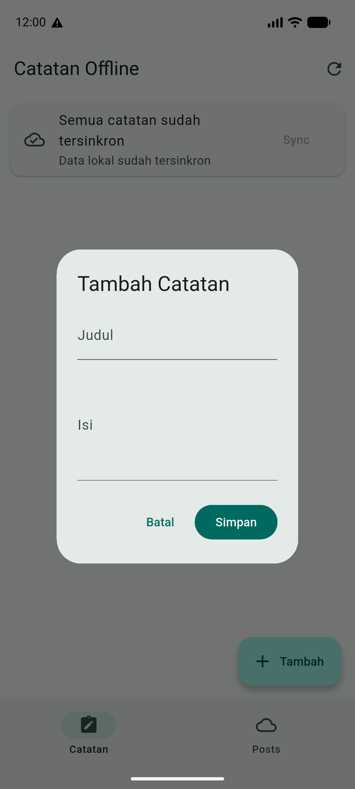
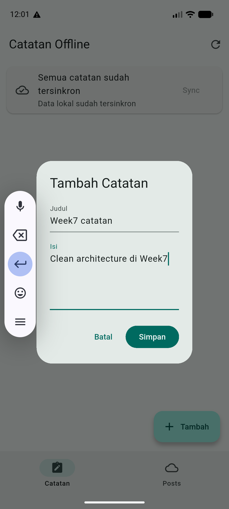
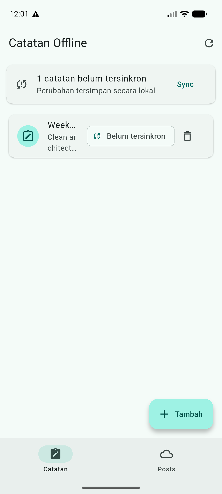
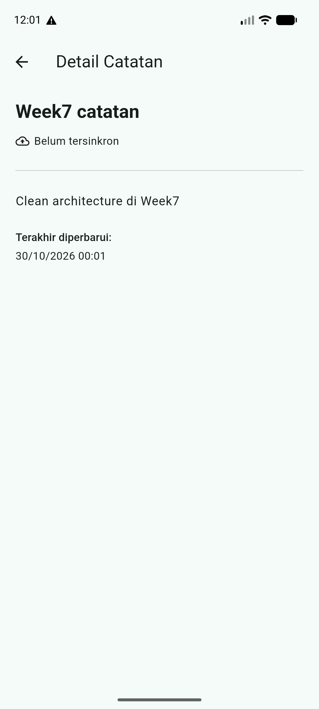
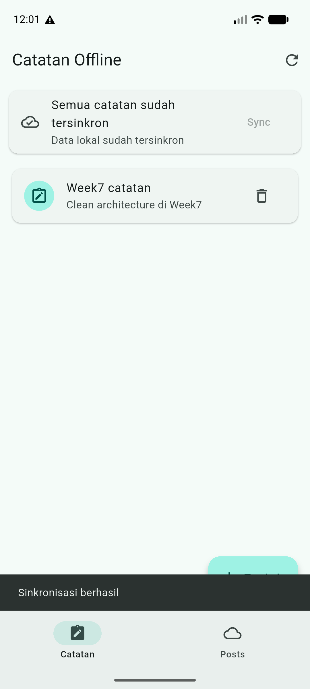
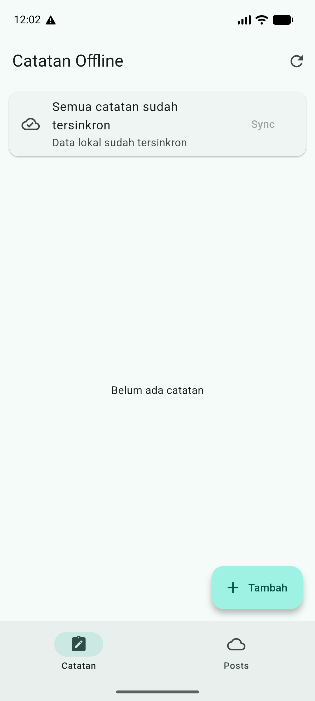
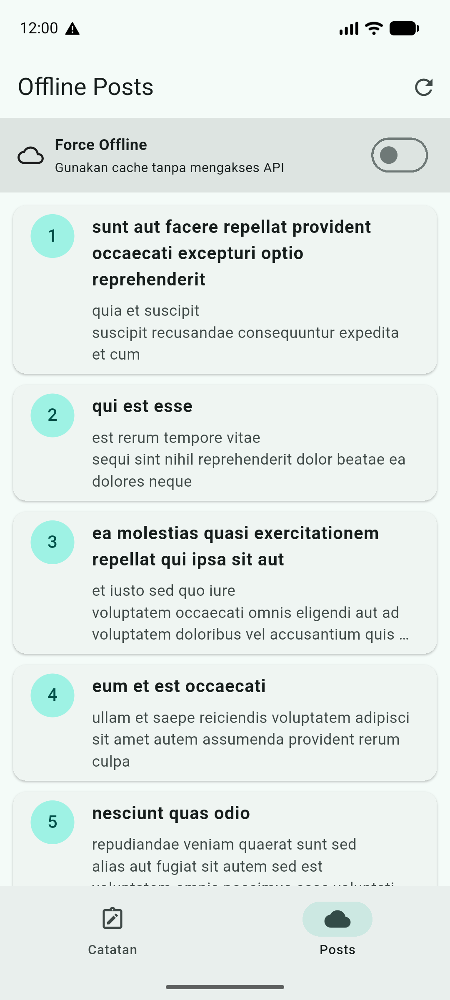
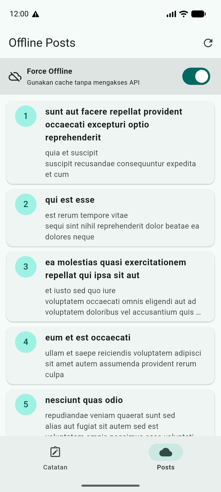

# Laporan Praktikum 07 — Clean Architecture

| Keterangan | Data |
|---|---|
| Nama | Sileysa Faedatul Nuraini |
| NIM | 244107020231 |
| Kelas | TI-3F |
| Mata Kuliah | Pemrograman Mobile |
| Pertemuan | Minggu 7 |

Project ini merupakan refactor feature-first dari project Flutter Minggu 5
(`week5_offline_notes`), bukan aplikasi atau fitur bisnis baru. Project Week 7 berisi struktur
Flutter yang dapat dijalankan secara mandiri.

## Tujuan praktikum

- Memisahkan kode menjadi presentation, domain, dan data.
- Menjaga domain bebas dari framework dan detail persistence/network.
- Memisahkan entity dari model SQLite/API.
- Menggunakan repository interface dan dependency injection Riverpod.
- Menguji use case dengan repository palsu, tanpa database atau jaringan.

## Arsitektur dan arah dependency

```text
lib/
├── core/
│   ├── failures.dart
│   └── format.dart
├── features/
│   ├── notes/
│   │   ├── domain/
│   │   │   ├── entities/note.dart
│   │   │   ├── repositories/note_repository.dart
│   │   │   └── usecases/
│   │   │       ├── get_notes.dart
│   │   │       └── sync_notes.dart
│   │   ├── data/
│   │   │   ├── models/note_model.dart
│   │   │   └── repositories/note_repository_impl.dart
│   │   └── presentation/
│   │       ├── providers/notes_providers.dart
│   │       └── widgets/note_tile.dart
│   └── posts/
│       ├── domain/
│       │   ├── entities/post.dart
│       │   ├── repositories/post_repository.dart
│       │   └── usecases/get_remote_posts.dart
│       ├── data/
│       │   ├── models/post_model.dart
│       │   └── repositories/post_repository_impl.dart
│       └── presentation/providers/posts_providers.dart
├── pages/
│   ├── notes_page.dart
│   ├── note_detail_page.dart
│   └── offline_posts_page.dart
└── providers/app_providers.dart

presentation ───────> domain <─────── data
                           ^
                 data implements domain contracts
```

Domain memiliki entity, kontrak repository, use case, dan `Failure`. Data mengimplementasikan
kontrak tersebut menggunakan sqflite/Dio dan memetakan model ke entity. Presentation berisi
page, provider, dan notifier. Provider Riverpod adalah composition root yang memasangkan
interface dengan implementasi.

### Keputusan desain

- Entity `Note` dan `Post` murni Dart, tanpa `toMap`, `fromMap`, atau `toJson`.
- `NoteModel` dan `PostModel` menangani pemetaan SQLite/API.
- Repository mengubah kegagalan storage/network menjadi `Failure` dengan pesan yang aman
  ditampilkan, bukan membocorkan exception teknis ke UI.
- `GetNotes` memisahkan operasi baca yang diuji dengan fake repository.
- `SyncNotes` menjadi use case karena mengorkestrasi pembacaan dirty count dan perubahan status.
- Add/delete notes tetap langsung dari notifier ke repository interface; use case satu-baris
  tidak ditambahkan jika tidak menambahkan aturan bisnis.
- Posts mempertahankan cache SQLite dan mode Force Offline.

Prompt AI, draf usulan, tabel usulan-versus-keputusan, serta trade-off didokumentasikan di
[docs/clean-architecture-ai-challenge.md](docs/clean-architecture-ai-challenge.md).

## Fitur aplikasi

- **Notes:** menampilkan, menambah, menghapus, dan membuka detail catatan lokal.
- **Dirty flag dan sync:** catatan baru ditandai belum tersinkron; tombol Sync menjalankan
  simulasi sinkronisasi lokal.
- **Offline Posts:** mengambil posts dari API, menyimpan cache SQLite, dan menyediakan toggle
  Force Offline.
- **Preferensi:** mempertahankan fitur tema/pengaturan dari project asal.

## Bukti run emulator Minggu 7

Aplikasi dijalankan pada Android Emulator (Android 17, API 37; resolusi 1080 × 2400). Alur Notes diuji sampai hapus catatan; Offline Posts diuji mengambil data JSONPlaceholder, menyimpan cache SQLite, lalu menampilkan cache dalam mode Force Offline. Sinkronisasi Notes hanya mengubah status `dirty`; tidak ada backend.
Navigasi bawah, kartu status sync, tile catatan, dan kontrol Force Offline mempertahankan pola visual project Week 5; perubahan Minggu 7 difokuskan pada pemisahan arsitektur di balik UI.

| Screenshot | Bukti |
|---|---|
|  | Tampilan awal sebelum ada catatan. |
|  | Form tambah catatan. |
|  | Contoh isi catatan sebelum disimpan. |
|  | Catatan tersimpan lokal dengan status belum tersinkron. |
|  | Detail entity dan waktu update yang diformat. |
|  | Hasil simulasi sinkronisasi; pesan sukses terlihat. |
|  | Catatan terhapus dan empty state kembali. |
|  | Navigasi bawah mempertahankan perpindahan antara Catatan dan Posts. |
|  | Daftar Post berhasil diambil dari JSONPlaceholder. |
|  | Daftar tetap tampil dari cache setelah Force Offline diaktifkan. |

## 6. AI Challenge

Challenge ini mengaudit dan mengusulkan refactor untuk project `campus_notify` Minggu 6; proposal tidak berarti file project Minggu 6 sudah dimigrasikan. Simpan prompt, draf awal AI, keputusan final, pemetaan file, dan output grep yang benar-benar dijalankan di folder `docs/`:

- [Prompt AI](docs/ai-prompt.md)
- [Output awal AI](docs/ai-output.md)
- [Keputusan dan verifikasi](docs/ai-decisions-and-verification.md)

Audit aktual mengoreksi asumsi dalam prompt: `lib/widgets/` tidak ada, halaman tidak memanggil Dio, `buildApiClient` tidak memiliki pemanggil, dan halaman announcement masih statis. Keputusan final menolak membuat lapisan repository/use case announcement sebelum ada sumber data atau aturan bisnis. Hasil grep di dokumen adalah kondisi awal, bukan klaim bahwa campus_notify sudah direfactor.

## 8. Tugas, refleksi, dan referensi

### 8.1 Mini project / Industry Challenge

Target tugas adalah merefactor repository yang sama, bukan membuat repository Git baru. Di repository ini, implementasi ada di folder `07-week-7-clean-architecture/`; source Week 5 dipertahankan sebagai baseline pembanding. Project Week 7 berisi Notes dan Offline Posts dengan struktur feature-first.

| Kriteria | Hasil pada project ini |
|---|---|
| Minimal satu fitur penuh | Notes: entity dan kontrak repository di `domain`, use cases/failure, SQLite model dan repository impl di `data`, serta provider/pages di `presentation`. Posts juga memiliki pemisahan API/cache yang sama. |
| Dependency rule | Tiga grep di Bagian 7.2 dijalankan pada Notes, Posts, Auth domain, dan core; ketiganya tanpa hasil. |
| Behavior dan UI | Navigasi Catatan/Posts, tambah/detail/hapus/sync Notes, serta API/cache/Force Offline Posts dijalankan pada emulator. Baseline Week 5 dan hasil Week 7 ditautkan di tabel screenshot. |
| Minimal dua test | `get_notes_test.dart` mencakup sukses dan failure dengan fake repository. `get_posts_test.dart` juga menguji hasil dan failure. Seluruh 16 test lulus pada verifikasi terakhir. |
| AI Challenge | Prompt, draf awal, tabel usulan-vs-keputusan-final, dan bukti audit tersedia di `docs/ai-prompt.md`, `docs/ai-output.md`, dan `docs/ai-decisions-and-verification.md`. |
| Struktur dan cara menjalankan | Folder ini memiliki `lib/`, `test/`, `docs/`, `screenshots/`, `pubspec.yaml`, serta README ini. Jalankan `flutter pub get`, `flutter analyze`, `flutter test`, lalu `flutter run` dari folder project. |

#### Bukti screenshot before/after

Screenshot before adalah tangkapan project Week 5 yang sudah ada; screenshot after adalah tangkapan emulator project Week 7. Data contoh pada kedua tangkapan tidak selalu identik, tetapi menggambarkan alur dan UI fitur yang sama.

| Fitur/alur | Week 5 — before | Week 7 — after |
|---|---|---|
| Catatan lokal dan status belum sync | [ModPesBefore.png](../05-week-5-local-storage-offline-first/week5_offline_notes/screenshots/ModPesBefore.png) | [11-notes-week5-parity.png](screenshots/11-notes-week5-parity.png) |
| Catatan setelah sync | [ModPesAfter.png](../05-week-5-local-storage-offline-first/week5_offline_notes/screenshots/ModPesAfter.png) | [06-notes-synced.png](screenshots/06-notes-synced.png) |
| Posts dari API | [PesPostOnline.png](../05-week-5-local-storage-offline-first/week5_offline_notes/screenshots/PesPostOnline.png) | [09-posts-online.png](screenshots/09-posts-online.png) |
| Posts dari cache / Force Offline | [PesPostsOffline.png](../05-week-5-local-storage-offline-first/week5_offline_notes/screenshots/PesPostsOffline.png) | [10-posts-force-offline.png](screenshots/10-posts-force-offline.png) |

#### Hasil dan batas klaim

- Implementasi dan verifikasi berada di folder Week 7 pada **repository Git yang sama**; Week 5 tidak diubah sehingga tetap menjadi sumber baseline.
- Hasil verifikasi terakhir: `flutter analyze` bersih, 16 test lulus, dan ketiga pemeriksaan dependency rule tanpa hasil.
- Screenshot merupakan bukti UI/alur setelah migrasi. Screenshot bukan bukti bahwa database lama diimpor; Week 7 menggunakan database aplikasi sendiri.
- Push ke repository portfolio belum dilakukan. Jangan force-push: branch lokal saat pemeriksaan memiliki riwayat yang tertinggal dari remote dan perubahan Week 7 belum dipublikasikan. Rekonsiliasikan branch dan tinjau perubahan sebelum push.

### 8.2 Refleksi

#### Mengapa interface repository tinggal di domain?

Domain menentukan kebutuhan bisnisnya—misalnya `fetchNotes()`—tanpa menentukan apakah data berasal dari SQLite, API, atau fake test. Implementasi data bergantung ke kontrak domain, bukan sebaliknya. Jika interface dibalik dan ditaruh di data, domain harus mengenal detail infrastruktur; pergantian SQLite/Dio dapat merambat ke aturan bisnis, dan pengujian domain lebih sulit dilakukan tanpa package atau adapter data.

#### Kapan use case dibutuhkan?

Gunakan use case saat operasi punya aturan bisnis, mengoordinasikan beberapa repository, atau merupakan aksi bisnis yang ingin diuji sebagai unit tersendiri. Operasi CRUD sederhana yang hanya meneruskan satu pemanggilan dapat langsung dilakukan notifier ke repository. Pada contoh ini, `SyncNotes` layak menjadi use case karena memperbarui status sync; `GetNotes` dan `GetPosts` juga dipertahankan sebagai seam eksplisit untuk demonstrasi serta test. Pada aplikasi kecil, use case pass-through untuk tambah/hapus dapat disederhanakan tanpa mengubah kontrak repository.

#### Apa biaya over-engineering use case satu-baris?

Setiap abstraksi tambahan membawa file, provider, import, dan titik navigasi kode. Untuk tim kecil, biaya tersebut menambah boilerplate dan beban memahami perubahan tanpa memberi aturan bisnis baru. Biayanya sepadan bila use case menjadi batas kebijakan yang jelas, punya orkestrasi, dipakai di beberapa entry point, atau perlu diuji terpisah; jika hanya meneruskan panggilan repository, sederhanakan.

#### Bagian AI yang ditolak atau disederhanakan

- Tidak membuat repository/use case/data source untuk announcements Minggu 6 karena halaman legacy masih statis dan belum ada sumber data nyata.
- Tidak menganggap asumsi prompt sebagai fakta: audit menemukan `lib/widgets/` tidak ada, halaman tidak memanggil Dio secara langsung, dan `buildApiClient` belum digunakan.
- Tidak memasukkan Dio, SQLite, atau Firebase ke domain. API dan cache Posts berada di data.
- Tidak menambah dependency-injection package; Riverpod menjadi composition point.
- Demo Auth Week 7 tetap diberi batas jelas sebagai simulasi lokal, bukan klaim backend authentication atau migrasi Auth Week 6.
